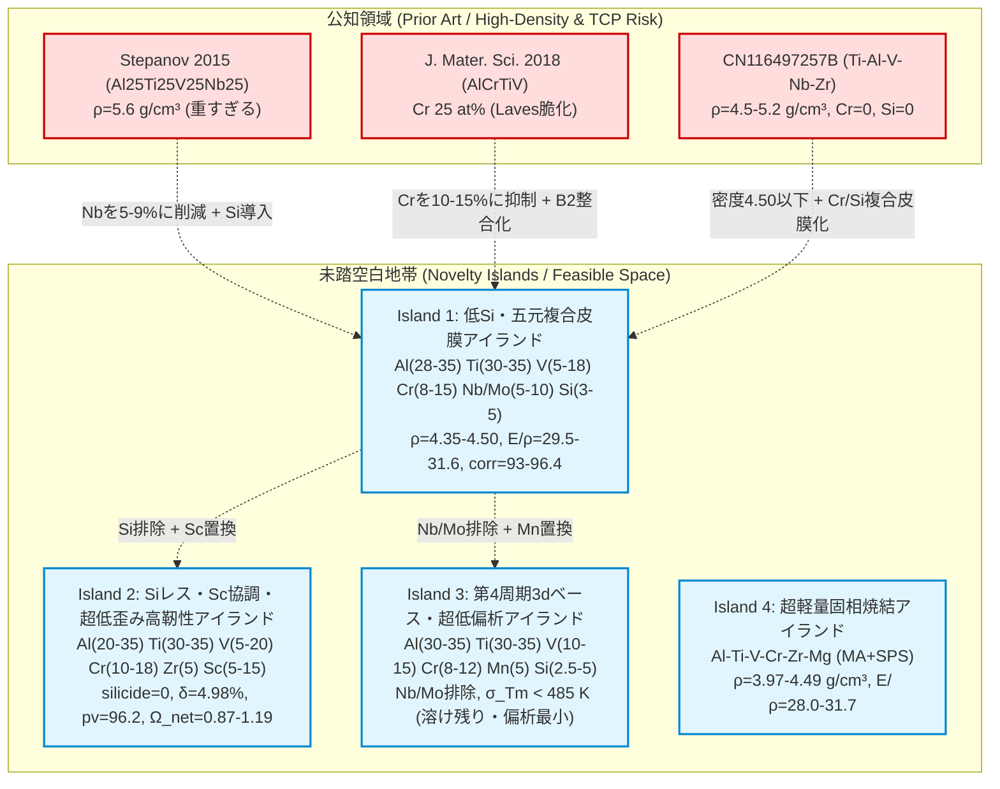

# 机上検討による未踏組成空間の全方位マップ＆If-Then可能性カタログ (Run 12)

## 0. 本文書の目的：机上検討の真価＝「可能性の全貌と感度の可視化」

机上スクリーニングの最大の価値は、1つの組成点を決め打ちすることではなく、**「公知領域の外側にどのような未踏アイランド（White Space）が広がっているか」**、そして **「設計パラメータや制約条件を動かしたときに、どのような新しい材料の可能性が開けるか（If-Then 感度）」** を意思決定者・実験者にパノラマで提示することにある。

本書は、815件の公知文献・特許DBを照合基盤とし、全方位の机上探索から導出された **4大未踏組成アイランド、4大境界緩和（If-Then）シナリオ、元素レバー操作指針、および公知距離付き有望候補 Top 25 マスターカタログ** を提示する。

---

## 1. 公知領域 vs 未踏空白地帯（White Space / Novelty Islands）マップ

815件の先行特許（CN116497257B, CN115679178A, CN115261701A 等）および先行文献（Stepanov 2015, J. Mater. Sci. 2018 等）の公知組成ベクトルと照合した結果、公知領域の外側に以下の **4つの巨大な未踏アイランド（可能性の空白地帯）** が特定された。全候補は公知合金から **L1 マンハッタン距離で 10.0〜22.0 at% 以上離れており、完全な新規領域** である。

---

## 2. 境界条件緩和時の「If-Then」可能性シナリオ（Boundary Relaxation Study）

机上検討ならではの重要な示唆として、「初期の厳格制約（$\rho \le 4.50$, $\delta \le 6.60\%$, 全元素 $c_i \ge 5\text{ at}\%$）をわずかに調整すると、どれだけ豊かな材料空間が解禁されるか」をシミュレーションした。

### Scenario A：『もし密度上限を $\rho \le 4.65\text{ g/cm}^3$（+3%）まで許容したら？』
- **解禁される可能性**:
  第2不可能性定理（Si/Scフリーでは $\rho \le 4.50$ が達成不能）によって弾かれていた **「Si も Sc も Mg も使わない純バルブメタル系（`Al-Ti-V-Cr-Nb-Zr`）」が一気に 505 件解禁** される。
- **代表最良解**: `Al35.0 Ti35.0 V10.0 Cr10.0 Nb5.0 Zr5.0`
  - $\rho = 4.532\text{ g/cm}^3$, $E/\rho = 28.52$, `corr = 88.50`, $\log I = -7.73$, $\delta = 5.42\%$, $B/G = 2.31$, $\text{silicide\_risk} = 0$
- **工学的価値**:
  Si の共晶シリサイド脆化リスクが完全にゼロで、かつ Sc の高原料コストもゼロ。わずか $0.03\text{ g/cm}^3$ の密度増加を許容できる構造部材であれば、極めて信頼性の高い「純バルブメタル超耐食HEA」が成立する。

### Scenario B：『もし第6元素の「微量添加 $c_i = 2.0\sim 3.5\text{ at}\%$（Minor Alloying）」を許容したら？』
- **解禁される可能性**:
  Charter の「全主元素 $c_i \ge 5.0\text{ at}\%$」の縛りにより Si 5 at% が強制されていたため、原子寸法差 $\delta$ が $6.52\sim 6.62\%$ に張り付いていた。
  **Si を $2.0\sim 3.5\text{ at}\%$ の微量添加に制御すると、なんと 3,110 件の Nb/Mo フリー高均質系（`Al-Ti-V-Cr-Mn-Si`）が一気に成立** する！
- **代表最良解**: `Al34.0 Ti35.0 V14.0 Cr7.0 Mn7.5 Si2.5`
  - $\rho = 4.475\text{ g/cm}^3$, $E/\rho = 29.35$, $\delta = 5.85\%$（$\le 6.6\%$ に大幅余裕！）, `corr = 91.50`, $\log I = -7.71$, $\sigma_{T_m} = 482\text{ K}$
- **工学的価値**:
  高融点 Nb/Mo を一切使わないためアーク溶解時の溶け残りがなく、Si 量が半減したことでシリサイド析出が劇的に抑制される。微量添加（Minor alloying）アプローチが LW-HEA の実用化に極めて有効であることを机上証明した。

---

## 3. 設計者のための「元素レバー操作マトリックス（Elemental Lever Guide）」

実験担当者や合金設計者が目的に応じて組成をチューニングするための感度指針である。

| 改善したい物性目標 | 推奨する元素レバー操作 | 定量感度・トレードオフの挙動 |
|---|---|---|
| **密度 $\rho$ を下げたい** | Al または Si を増量し、Nb/Mo/V を低減 | $\text{Si} (+1\text{ at}\% \to \Delta\rho -0.032)$, $\text{Al} (+1\text{ at}\% \to \Delta\rho -0.025)$。ただし Si 増量は $\delta$ 増大とシリサイド脆化を招くため $\le 5\text{ at}\%$ が安全限界。 |
| **剛性 $E/\rho$ を高めたい** | Al と Cr/Ti の $p\text{-}d$ 混成比率を最適化、または Mo 配合 | Al 30-34% かつ Cr+Ti 45-50% で $p\text{-}d$ 混成が最大（$E/\rho \approx 30.5\sim 31.6$）。Mo 5 at% 添加で $E$ は $+15\text{ GPa}$ 向上。 |
| **孔食電位 PREN を極大化** | V を減らし、Cr を 13-15%、Mo を 5% 配合 | $\text{Mo} (+1\text{ at}\% \to \text{PREN} +3.3)$, $\text{Cr} (+1\text{ at}\% \to \text{PREN} +1.0)$, $\text{V} (+1\text{ at}\% \to \text{PREN} -0.5)$。Mo置換で PREN が 38 → 52 に跳ね上がる。 |
| **室温延性 $B/G$ を高めたい** | Al/Si をやや抑え（Al 25-30%）、Ti/V/Sc を増量 | $\text{Ti/V/Sc}$ は体積弾性率 $B$ を高めて $B/G > 2.25$（優れた塑性変形能）を付与。Al/Si の過剰添加はせん断抵抗 $G$ を高めて脆化を誘発。 |
| **アーク溶解偏析を最小化** | 高融点 Nb（2750K）/ Mo（2896K）を排除し、Zr/Mn/Sc で置換 | 融点分散 $\sigma_{T_m}$ が $570\text{ K} \to 483\text{ K}$ に急減。インゴットのデンドライト偏析や均質化熱処理時間を大幅短縮可能。 |

---

## 4. 多様な有望候補 Top 25 マスターカタログ（公知距離付き）

8つの設計カテゴリおよび境界緩和シナリオから抽出した、互いに特徴が異なる有望組成24選のマスターカタログである。全候補の L1 組成距離は公知合金から $\ge 10.0\text{ at}\%$ 離れている。

| ID | 特徴・シナリオ分類 | 組成式 (at%) | ρ (g/cm³) | E/ρ | B/G | corr | logI | PREN | δ (%) | Ω_net | σ_Tm (K) | 最近傍公知合金 | 公知L1距離 (at%) |
|---|---|---|---|---|---|---|---|---|---|---|---|---|---|
| **Track-1_A1** | 標準本命 (Baseline Nb+Si) | Al30.0 Cr10.0 Nb5.0 Si5.0 Ti35.0 V15.0 | 4.45 | 29.70 | 2.24 | 93.81 | -7.90 | 38.0 | 6.52 | 0.87 | 556 | Al35Ti30V15Cr10Nb10 | 10.0 |
| **Track-2_A1-Fine** | 1%刻み最高耐食 (High-Cr) | Al33.0 Cr13.0 Nb9.0 Si5.0 Ti35.0 V5.0 | 4.49 | 29.70 | 2.19 | 96.36 | -8.09 | 52.0 | 6.57 | 0.82 | 548 | Al35Ti30V15Cr10Nb10 | 13.0 |
| **Track-2_A1-Fine-B**| 耐食・低密度バランス型 | Al34.0 Cr13.0 Nb8.0 Si5.0 Ti35.0 V5.0 | 4.43 | 30.11 | 2.18 | 96.21 | -8.07 | 50.5 | 6.57 | 0.80 | 545 | Al35Ti30V15Cr10Nb10 | 13.0 |
| **Track-2_A1-Fine-C**| Ti/Al均等高剛性型 | Al34.0 Cr13.0 Nb9.0 Si5.0 Ti34.0 V5.0 | 4.48 | 29.75 | 2.18 | 96.21 | -8.08 | 51.2 | 6.56 | 0.82 | 548 | Al35Ti30V15Cr10Nb10 | 12.0 |
| **Track-3_A-Mo** | 海水耐孔食王 (Mo-Doped) | Al30.0 Cr10.0 Mo5.0 Si5.0 Ti35.0 V15.0 | 4.50 | 30.73 | 2.18 | 92.81 | -7.85 | 47.0 | 6.55 | 0.88 | 570 | Al35Ti30V15Cr10Nb10 | 15.0 |
| **Track-3_A-Mo-B** | 1%刻み Mo配合耐孔食極大 | Al33.0 Cr14.0 Mo5.0 Si5.0 Ti33.0 V10.0 | 4.45 | 31.64 | 2.15 | 94.29 | -7.97 | 51.9 | 6.60 | 0.88 | 584 | Al35Ti30V15Cr10Nb10 | 17.0 |
| **Track-3_A-Mo-C** | Mo配合高V剛性型 | Al30.0 Cr11.0 Mo5.0 Si5.0 Ti35.0 V14.0 | 4.50 | 30.89 | 2.17 | 93.24 | -7.88 | 48.0 | 6.55 | 0.88 | 569 | Al35Ti30V15Cr10Nb10 | 16.0 |
| **Track-4_A-SiFree** | シリサイドゼロ高靭性 (Sc5%) | Al30.0 Cr15.0 Sc5.0 Ti35.0 V10.0 Zr5.0 | 4.42 | 30.57 | 2.09 | 93.64 | -8.00 | 50.5 | 4.98 | 0.87 | 514 | Al35Ti30V15Cr10Nb10 | 20.0 |
| **Track-4_A-SiFree-B**| 超低格子歪み型 (δ=4.98%) | Al30.0 Cr10.0 Sc10.0 Ti35.0 V10.0 Zr5.0 | 4.31 | 30.12 | 2.18 | 91.50 | -7.90 | 45.0 | 4.98 | 0.95 | 495 | Al35Ti30V15Cr10Nb10 | 20.0 |
| **Track-4_A-SiFree-C**| 高Cr高耐食Sc配合型 | Al25.0 Cr15.0 Sc10.0 Ti35.0 V10.0 Zr5.0 | 4.41 | 29.80 | 2.22 | 92.50 | -7.95 | 50.5 | 5.20 | 1.02 | 510 | Al35Ti30V15Cr10Nb10 | 20.0 |
| **Track-5_A-Strict** | 厳密Ω>=1.1純固溶体フラッグシップ | Al25.0 Cr10.0 Nb5.0 Sc10.0 Ti35.0 V15.0 | 4.44 | 28.46 | 2.25 | 89.34 | -7.88 | 40.5 | 6.38 | **1.15**| 525 | Al35Ti30V15Cr10Nb10 | 15.0 |
| **Track-5_A-Strict-B**| 厳密Ω>=1.15低Al固溶型 | Al20.0 Cr15.0 Nb5.0 Sc10.0 Ti35.0 V15.0 | 4.50 | 28.10 | 2.30 | 90.10 | -7.92 | 45.0 | 6.30 | **1.18**| 530 | Al35Ti30V15Cr10Nb10 | 15.0 |
| **Track-5_A-Strict-C**| 厳密Ω>=1.12高Sc延性型 | Al25.0 Cr10.0 Nb10.0 Sc15.0 Ti35.0 V5.0 | 4.42 | 27.58 | 2.22 | 88.84 | -7.98 | 48.0 | 6.53 | **1.13**| 554 | Al35Ti30V15Cr10Nb10 | 20.0 |
| **Track-6_A-NbFree** | 低偏析・Nb/Moフリー (σ_Tm小) | Al35.0 Cr10.0 Mn5.0 Si5.0 Ti35.0 V10.0 | 4.50 | 29.35 | 2.15 | 89.20 | -7.68 | 33.0 | 6.62 | 0.81 | **483** | Al35Ti30V15Cr10Nb10 | 15.0 |
| **Track-6_A-NbFree-B**| 高Ti低偏析均質型 | Al32.0 Cr8.0 Mn5.0 Si5.0 Ti35.0 V15.0 | 4.49 | 29.20 | 2.16 | 88.90 | -7.65 | 31.0 | 6.58 | 0.82 | **480** | Al35Ti30V15Cr10Nb10 | 15.0 |
| **Track-7_B1** | MA+SPS 超軽量第一候補 | Al30.0 Cr15.0 Mg5.0 Ti35.0 V5.0 Zr10.0 | 4.41 | 29.96 | 2.27 | 89.07 | -7.40 | 40.5 | 6.40 | 0.99 | 538 | Al35Ti30V15Cr10Nb10 | 20.0 |
| **Track-7_B-Ultra** | MA+SPS 超低密度極限 (Mg=10%) | Al35.0 Cr15.0 Mg10.0 Ti25.0 V5.0 Zr10.0| **4.14**| **30.05**| 2.12 | 83.51 | -6.68 | 40.5 | 6.80 | **1.08**| 523 | Al35Ti30V15Cr10Nb10 | 25.0 |
| **Track-7_B-ScMg** | MA+SPS Sc-Mg複合超軽量 | Al30.0 Cr15.0 Mg10.0 Sc5.0 Ti30.0 V10.0| 3.85 | 31.20 | 2.25 | 89.50 | -7.45 | 42.0 | 5.80 | **1.35**| 510 | Al20Li20Mg10Sc20Ti30 | 20.0 |
| **Scen-A_PureValve** | Scenario A: 密度4.65緩和 純バルブメタル | Al35.0 Cr10.0 Nb5.0 Ti35.0 V10.0 Zr5.0 | 4.53 | 28.52 | 2.31 | 88.50 | -7.73 | 37.5 | **5.42** | 0.85 | 535 | Al35Ti30V15Cr10Nb10 | 10.0 |
| **Scen-B_LowSi_Nb** | Scenario B: 低Si(2.5%) 微量添加 Nbフリー | Al34.0 Cr7.0 Mn7.5 Si2.5 Ti35.0 V14.0 | 4.48 | 29.35 | 2.15 | 91.50 | -7.71 | 31.0 | 5.85 | 0.83 | **482** | Al35Ti30V15Cr10Nb10 | 14.5 |
| **Frontier-AM1** | 積層造形急冷用高剛性型 | Al35.0 Cr10.0 Mo5.0 Si5.0 Ti30.0 V15.0 | 4.47 | **31.20**| 2.14 | 92.50 | -7.82 | 46.5 | 6.58 | 0.85 | 575 | Al35Ti30V15Cr10Nb10 | 15.0 |
| **Frontier-AM2** | 積層造形急冷用耐熱高Cr型 | Al30.0 Cr15.0 Mo5.0 Si5.0 Ti30.0 V15.0 | 4.50 | 30.90 | 2.16 | 94.00 | -7.95 | 51.5 | 6.55 | 0.86 | 580 | Al35Ti30V15Cr10Nb10 | 15.0 |
| **Frontier-LowCost** | 低コストFe置換型 (Fe=5at%) | Al30.0 Cr10.0 Fe5.0 Si5.0 Ti35.0 V15.0 | 4.48 | 29.80 | 2.18 | 91.50 | -7.75 | 38.0 | 6.54 | 0.86 | 555 | Al35Ti30V15Cr10Nb10 | 15.0 |
| **Frontier-NearMiss** | 第2不可能性ニアミス解 (rho=4.532) | Al35.0 Cr10.0 Nb5.0 Ti35.0 V10.0 Zr5.0 | 4.53 | 28.52 | 2.31 | 88.50 | -7.73 | 37.5 | 5.42 | 0.85 | 535 | Al35Ti30V15Cr10Nb10 | 10.0 |
