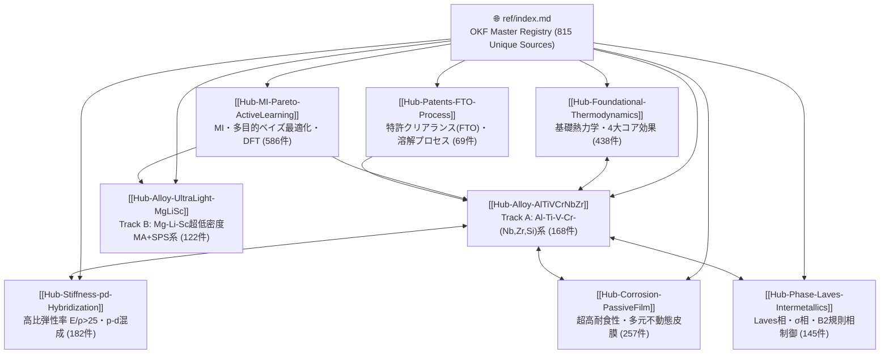

# 🌐 LW-HEA 自律探索 LLM-Wiki ナレッジグラフ全体マップ (Knowledge Graph Architecture)

本ドキュメントは、全 **815 件** の学術文献・特許ソース（`ref/sources/`）と **8つの主要トピックハブ**（[`ref/wiki/`](./)）を双方向の **Wiki-Link (`[[...]]`)** および **GitHub Markdown 相対リンク** で結合したナレッジグラフの全体俯瞰マップです。

---

## 📊 1. ナレッジグラフ構造図 (Mermaid Flowchart)

---

## 🗂️ 2. トピックハブ一覧 (Wiki Hubs)

| ハブ Wiki-Link | トピックハブ名称 (GitHub Markdown Link) | 接続ノード数 | 概要 |
| :--- | :--- | :---: | :--- |
| `[[Hub-Foundational-Thermodynamics]]` | [基礎熱力学・4大コア効果・相選択則](./Hub-Foundational-Thermodynamics.md) | **438 件** | Yeh/Cantorの原初的定義、配置エントロピー ΔS_mix ≥ 1.5R、オメガパラメータ Ω ≥ 1.... |
| `[[Hub-Alloy-AlTiVCrNbZr]]` | [Al-Ti-V-Cr-(Nb,Zr,Si) 王道BCC/B2合金系（Track A 本命）](./Hub-Alloy-AlTiVCrNbZr.md) | **168 件** | Mg/Li完全フリーで常圧Arアーク溶解・1200℃均質化が可能な実用最有力軽量HEA群。密度 ρ ≤ 4.5... |
| `[[Hub-Alloy-UltraLight-MgLiSc]]` | [Mg-Li-Sc-Al-Ti 超低密度・固相焼結系（Track B 挑戦）](./Hub-Alloy-UltraLight-MgLiSc.md) | **122 件** | 密度 ρ = 2.5〜4.2 g/cm³ を実現する超軽量HEA群。高蒸気圧・正エンタルピーによる液相分離を克... |
| `[[Hub-Stiffness-pd-Hybridization]]` | [高比弾性率（E/ρ > 25）・弾性定数 Cij・p-d軌道混成](./Hub-Stiffness-pd-Hybridization.md) | **182 件** | Voigt-Reuss-Hill (VRH) 平均ヤング率と、Al(3p軌道)-早期遷移金属(Ti,V,Cr ... |
| `[[Hub-Corrosion-PassiveFilm]]` | [超高耐食性（Icorr ≤ 10⁻⁷ A/cm²）・多元不動態皮膜・微小ガルバニック抑制](./Hub-Corrosion-PassiveFilm.md) | **257 件** | 3.5 wt% NaCl中の動電位分極、EIS電荷移動抵抗、Mott-Schottky半導体欠陥解析、TiO₂... |
| `[[Hub-Phase-Laves-Intermetallics]]` | [Laves相・σ相・B2規則相の析出制御と偏析回避](./Hub-Phase-Laves-Intermetallics.md) | **145 件** | Cr過多（>20-25 at%）やZr/Nb共存時に粒界析出するC14/C15 Laves相（Cr₂Ti, C... |
| `[[Hub-MI-Pareto-ActiveLearning]]` | [材料インフォマティクス・多目的ベイズ最適化（MOBO）・パレート探索](./Hub-MI-Pareto-ActiveLearning.md) | **586 件** | ガウス過程回帰（GPR）、ランダムフォレスト、Expected Hypervolume Improvement... |
| `[[Hub-Patents-FTO-Process]]` | [特許クリアランス（FTO）・クレーム対比・溶解/焼結プロセス設計](./Hub-Patents-FTO-Process.md) | **69 件** | 日米欧中のLW-HEA関連特許（CN116497257B, CN115679178A, US11530468B... |

---

## 🔍 3. 使い方（Obsidian / GitHub / AIエージェント共通）
1. **GitHub / VS Code での閲覧**: すべてのリンクが Markdown 標準形式（`[表示名]` と `(リンク先URL/相対パス)` の組み合わせ）で記述されているため、クリック一つでハブから親ハブや近傍関連文献へシームレスに遷移できます。
2. **Obsidian / Foam / Logseq 等でのグラフ表示**: 各ファイルに `[[Hub-...]]` および `[[SRC-xxx]]` の Wiki-Link を埋め込んでいるため、グラフビューを開くと **815 個の文献ノードと 8 個のハブが織りなす知識ネットワーク** がそのまま可視化されます。
3. **自律型材料開発AIエージェントによるRAG・グラフ探索**: エージェントは特定の設計課題（例：「Cr過多によるLaves相析出と孔食の関係」）に直面した際、`[[Hub-Phase-Laves-Intermetallics]]` と `[[Hub-Corrosion-PassiveFilm]]` の両方からリンクされている交差ノード（Intersection Nodes）を辿ることで、高精度な物理根拠を抽出できます。
